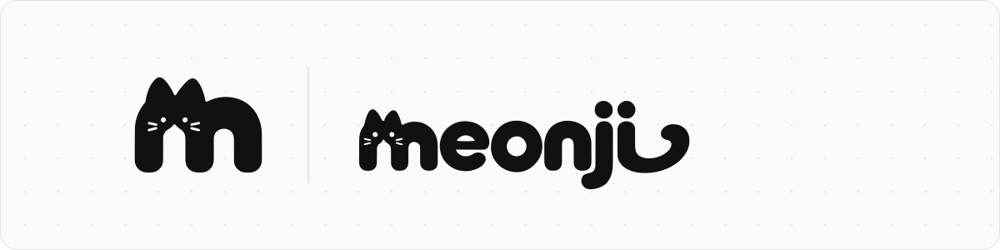
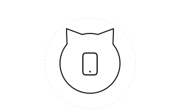
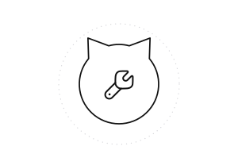

<picture>
  <source media="(prefers-color-scheme: dark)" srcset="./assets/banner-dark.svg">
  
</picture>

  

<b>먼지 (meonji)</b> 
앱, 도구, 게임을 만듭니다.

  

<a href="https://github.com/meonji-mon/MEONJI-Brand">MEONJI-Brand</a> &nbsp;&nbsp;·&nbsp;&nbsp; <a href="https://github.com/meonji-mon/agent-harness">agent-harness</a>

 

<picture>
  <source media="(prefers-color-scheme: dark)" srcset="./assets/divider-dark.svg">
  
</picture>

<h3 align="center"><picture><source media="(prefers-color-scheme: dark)" srcset="./assets/icons/user-circle-dark.svg"></picture>&nbsp; 소개</h3>

필요한 것을 직접 만들어 씁니다.

<table align="center">
  <tr>
    <td align="center" width="220">
      <picture><source media="(prefers-color-scheme: dark)" srcset="./assets/card-app-dark.svg"></picture> 
      <b>앱</b> 매일 쓰는 작은 앱  
    </td>
    <td align="center" width="220">
      <picture><source media="(prefers-color-scheme: dark)" srcset="./assets/card-tool-dark.svg"></picture> 
      <b>도구</b> macOS · Windows 작업 도구  
    </td>
    <td align="center" width="220">
      <picture><source media="(prefers-color-scheme: dark)" srcset="./assets/card-game-dark.svg"></picture> 
      <b>게임</b> 가볍게 즐기는 게임  
    </td>
  </tr>
</table>

로고와 제작 규격은 <a href="https://github.com/meonji-mon/MEONJI-Brand">MEONJI-Brand</a>, 코딩 에이전트와 일하는 규칙은 <a href="https://github.com/meonji-mon/agent-harness">agent-harness</a>에 정리합니다.

<picture>
  <source media="(prefers-color-scheme: dark)" srcset="./assets/divider-dark.svg">
  
</picture>

<h3 align="center"><picture><source media="(prefers-color-scheme: dark)" srcset="./assets/icons/layers-dark.svg"></picture>&nbsp; 기술 스택</h3>

<table align="center">
  <tr>
    <th align="center" width="220">APP</th>
    <th align="center" width="220">WEB · TOOLS</th>
    <th align="center" width="220">BACKEND</th>
  </tr>
  <tr>
    <td align="center" valign="top">Flutter Dart Swift</td>
    <td align="center" valign="top">TypeScript JavaScript Python</td>
    <td align="center" valign="top">Supabase</td>
  </tr>
</table>

<picture>
  <source media="(prefers-color-scheme: dark)" srcset="./assets/divider-dark.svg">
  
</picture>

<h3 align="center"><picture><source media="(prefers-color-scheme: dark)" srcset="./assets/icons/notebook-dark.svg"></picture>&nbsp; 일지</h3>

만들면서 정한 것과 배운 것을 짧게 남깁니다.

<table align="center">
  <tr>
    <td align="center" width="90"><code>10.25</code></td>
    <td width="570"><a href="journal/2026-10-25.md">브랜드 레포 공개, 로고 제작 규격서와 측정 프로그램</a></td>
  </tr>
  <tr>
    <td align="center" width="90"><code>10.24</code></td>
    <td width="570"><a href="journal/2026-10-24.md">브랜드 에셋 정리, 로고를 웹 주소로 쓰기로 결정</a></td>
  </tr>
</table>

<a href="journal/">전체 일지 보기 →</a>

<picture>
  <source media="(prefers-color-scheme: dark)" srcset="./assets/divider-dark.svg">
  
</picture>
