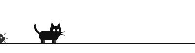

<picture>
  <source media="(prefers-color-scheme: dark)" srcset="./assets/banner-dark.svg">
  
</picture>

<h3>먼지 meonji</h3>

앱, 도구, 게임을 만듭니다. 필요한 것을 직접 만들어 씁니다. 만들면서 정한 것과 배운 것은 일지에 짧게 남깁니다.

<samp><a href="https://github.com/meonji-mon/MEONJI-Brand">brand</a> · <a href="journal/">일지</a></samp>

<picture>
  <source media="(prefers-color-scheme: dark)" srcset="./assets/divider-dark.svg">
  
</picture>

<h4><picture><source media="(prefers-color-scheme: dark)" srcset="./assets/icons/wrench-dark.svg"></picture>&nbsp; 만드는 것</h4>

<a href="https://meonji-mon.github.io/meonji-jump/"><b>먼지 달려</b></a> &nbsp;—&nbsp; 가볍게 즐기는 게임 
<a href="https://github.com/meonji-mon/MEONJI-Brand"><b>MEONJI-Brand</b></a> &nbsp;—&nbsp; 브랜드와 로고 제작 규격 
<a href="https://github.com/meonji-mon/agent-harness"><b>agent-harness</b></a> &nbsp;—&nbsp; 코딩 에이전트와 일하는 규칙

그 밖에 매일 쓰는 작은 앱과 macOS · Windows 작업 도구

<h4><picture><source media="(prefers-color-scheme: dark)" srcset="./assets/icons/layers-dark.svg"></picture>&nbsp; 기술 스택</h4>

<samp>APP&nbsp;&nbsp;&nbsp;&nbsp;&nbsp;&nbsp;&nbsp;&nbsp;&nbsp;&nbsp;&nbsp;Flutter · Dart · Swift</samp> 
<samp>WEB · TOOLS&nbsp;&nbsp;&nbsp;TypeScript · JavaScript · Python</samp> 
<samp>BACKEND&nbsp;&nbsp;&nbsp;&nbsp;&nbsp;&nbsp;&nbsp;Supabase</samp>

<h4><picture><source media="(prefers-color-scheme: dark)" srcset="./assets/icons/notebook-dark.svg"></picture>&nbsp; 일지</h4>

<samp>10.25</samp>&nbsp;&nbsp; <a href="journal/2026-10-25.md">브랜드 레포 공개, 로고 제작 규격서와 측정 프로그램</a> 
<samp>10.24</samp>&nbsp;&nbsp; <a href="journal/2026-10-24.md">브랜드 에셋 정리, 로고를 웹 주소로 쓰기로 결정</a>

<a href="journal/">전체 일지 보기 →</a>

<picture>
  <source media="(prefers-color-scheme: dark)" srcset="https://raw.githubusercontent.com/meonji-mon/meonji-mon/output/cat-dark.svg">
  
</picture>

<!-- GAMES:START -->
<h4><picture><source media="(prefers-color-scheme: dark)" srcset="./assets/icons/game-controller-dark.svg"></picture>&nbsp; 먼지 달려</h4>

<a href="https://meonji-mon.github.io/meonji-jump/"><picture><source media="(prefers-color-scheme: dark)" srcset="./assets/games/jump-preview-dark.svg"></picture></a>

고양이가 굴러오는 먼지를 뛰어넘는 달리기 게임. 스페이스나 탭으로 점프해요.

<a href="https://meonji-mon.github.io/meonji-jump/"><b>플레이하기 →</b></a>

<!-- GAMES:END -->

 

<samp>먼지 · 2026</samp>

