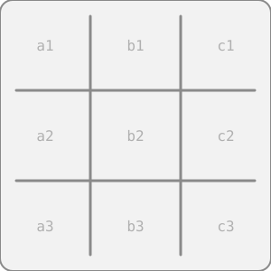
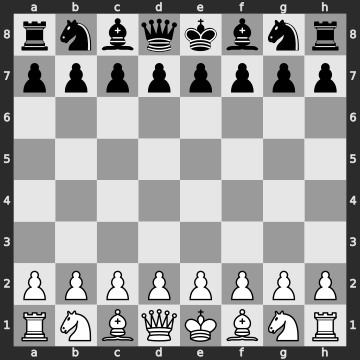

<picture>
  <source media="(prefers-color-scheme: dark)" srcset="./assets/banner-dark.svg">
  
</picture>

<h3>먼지 meonji</h3>

앱, 도구, 게임을 만듭니다. 필요한 것을 직접 만들어 씁니다. 만들면서 정한 것과 배운 것은 일지에 짧게 남깁니다.

<picture>
  <source media="(prefers-color-scheme: dark)" srcset="./assets/divider-dark.svg">
  
</picture>

  

<table align="center">
  <tr>
    <th colspan="2" align="left">만드는 것</th>
  </tr>
  <tr>
    <td align="left"><picture><source media="(prefers-color-scheme: dark)" srcset="./assets/icons/smart-phone-dark.svg"></picture>&nbsp; 앱</td>
    <td align="left">매일 쓰는 작은 앱</td>
  </tr>
  <tr>
    <td align="left"><picture><source media="(prefers-color-scheme: dark)" srcset="./assets/icons/wrench-dark.svg"></picture>&nbsp; 도구</td>
    <td align="left">macOS · Windows 작업 도구</td>
  </tr>
  <tr>
    <td align="left"><picture><source media="(prefers-color-scheme: dark)" srcset="./assets/icons/game-controller-dark.svg"></picture>&nbsp; 게임</td>
    <td align="left">가볍게 즐기는 게임</td>
  </tr>
  <tr>
    <th colspan="2" align="left">기술 스택</th>
  </tr>
  <tr>
    <td align="left">APP</td>
    <td align="left"><code>Flutter</code> <code>Dart</code> <code>Swift</code></td>
  </tr>
  <tr>
    <td align="left">WEB · TOOLS</td>
    <td align="left"><code>TypeScript</code> <code>JavaScript</code> <code>Python</code></td>
  </tr>
  <tr>
    <td align="left">BACKEND</td>
    <td align="left"><code>Supabase</code></td>
  </tr>
  <tr>
    <th colspan="2" align="left">일지</th>
  </tr>
  <tr>
    <td align="left">10.25</td>
    <td align="left"><a href="journal/2026-10-25.md">브랜드 레포 공개, 로고 제작 규격서와 측정 프로그램</a></td>
  </tr>
  <tr>
    <td align="left">10.24</td>
    <td align="left"><a href="journal/2026-10-24.md">브랜드 에셋 정리, 로고를 웹 주소로 쓰기로 결정</a></td>
  </tr>
  <tr>
    <td></td>
    <td align="left"><a href="journal/">전체 일지 보기 →</a></td>
  </tr>
  <tr>
    <th colspan="2" align="left">링크</th>
  </tr>
  <tr>
    <td align="left"><a href="https://github.com/meonji-mon/MEONJI-Brand">MEONJI-Brand</a></td>
    <td align="left">브랜드와 로고 제작 규격</td>
  </tr>
  <tr>
    <td align="left"><a href="https://github.com/meonji-mon/agent-harness">agent-harness</a></td>
    <td align="left">코딩 에이전트와 일하는 규칙</td>
  </tr>
</table>

 

<!-- GAMES:START -->
<h4>게임</h4>

칸이나 수를 누르면 이슈가 열려요. 그대로 제출하면 1분 안에 먼지가 받아 둡니다.

<table align="center">
  <tr><th align="left">틱택토 당신 X · 먼지 O</th></tr>
  <tr><td align="center"></td></tr>
  <tr><td align="left">둘 칸 &nbsp;<a href="https://github.com/meonji-mon/meonji-mon/issues/new?title=ttt%7Ca1&body=%EC%9D%B4%20%EC%9D%B4%EC%8A%88%EB%A5%BC%20%EA%B7%B8%EB%8C%80%EB%A1%9C%20%EC%A0%9C%EC%B6%9C%ED%95%98%EB%A9%B4%20%EC%88%98%EA%B0%80%20%EB%91%AC%EC%A0%B8%EC%9A%94.%20%EC%A0%9C%EB%AA%A9%EC%9D%80%20%EB%B0%94%EA%BE%B8%EC%A7%80%20%EB%A7%88%EC%84%B8%EC%9A%94."><code>a1</code></a> <a href="https://github.com/meonji-mon/meonji-mon/issues/new?title=ttt%7Cb1&body=%EC%9D%B4%20%EC%9D%B4%EC%8A%88%EB%A5%BC%20%EA%B7%B8%EB%8C%80%EB%A1%9C%20%EC%A0%9C%EC%B6%9C%ED%95%98%EB%A9%B4%20%EC%88%98%EA%B0%80%20%EB%91%AC%EC%A0%B8%EC%9A%94.%20%EC%A0%9C%EB%AA%A9%EC%9D%80%20%EB%B0%94%EA%BE%B8%EC%A7%80%20%EB%A7%88%EC%84%B8%EC%9A%94."><code>b1</code></a> <a href="https://github.com/meonji-mon/meonji-mon/issues/new?title=ttt%7Cc1&body=%EC%9D%B4%20%EC%9D%B4%EC%8A%88%EB%A5%BC%20%EA%B7%B8%EB%8C%80%EB%A1%9C%20%EC%A0%9C%EC%B6%9C%ED%95%98%EB%A9%B4%20%EC%88%98%EA%B0%80%20%EB%91%AC%EC%A0%B8%EC%9A%94.%20%EC%A0%9C%EB%AA%A9%EC%9D%80%20%EB%B0%94%EA%BE%B8%EC%A7%80%20%EB%A7%88%EC%84%B8%EC%9A%94."><code>c1</code></a> <a href="https://github.com/meonji-mon/meonji-mon/issues/new?title=ttt%7Ca2&body=%EC%9D%B4%20%EC%9D%B4%EC%8A%88%EB%A5%BC%20%EA%B7%B8%EB%8C%80%EB%A1%9C%20%EC%A0%9C%EC%B6%9C%ED%95%98%EB%A9%B4%20%EC%88%98%EA%B0%80%20%EB%91%AC%EC%A0%B8%EC%9A%94.%20%EC%A0%9C%EB%AA%A9%EC%9D%80%20%EB%B0%94%EA%BE%B8%EC%A7%80%20%EB%A7%88%EC%84%B8%EC%9A%94."><code>a2</code></a> <a href="https://github.com/meonji-mon/meonji-mon/issues/new?title=ttt%7Cb2&body=%EC%9D%B4%20%EC%9D%B4%EC%8A%88%EB%A5%BC%20%EA%B7%B8%EB%8C%80%EB%A1%9C%20%EC%A0%9C%EC%B6%9C%ED%95%98%EB%A9%B4%20%EC%88%98%EA%B0%80%20%EB%91%AC%EC%A0%B8%EC%9A%94.%20%EC%A0%9C%EB%AA%A9%EC%9D%80%20%EB%B0%94%EA%BE%B8%EC%A7%80%20%EB%A7%88%EC%84%B8%EC%9A%94."><code>b2</code></a> <a href="https://github.com/meonji-mon/meonji-mon/issues/new?title=ttt%7Cc2&body=%EC%9D%B4%20%EC%9D%B4%EC%8A%88%EB%A5%BC%20%EA%B7%B8%EB%8C%80%EB%A1%9C%20%EC%A0%9C%EC%B6%9C%ED%95%98%EB%A9%B4%20%EC%88%98%EA%B0%80%20%EB%91%AC%EC%A0%B8%EC%9A%94.%20%EC%A0%9C%EB%AA%A9%EC%9D%80%20%EB%B0%94%EA%BE%B8%EC%A7%80%20%EB%A7%88%EC%84%B8%EC%9A%94."><code>c2</code></a> <a href="https://github.com/meonji-mon/meonji-mon/issues/new?title=ttt%7Ca3&body=%EC%9D%B4%20%EC%9D%B4%EC%8A%88%EB%A5%BC%20%EA%B7%B8%EB%8C%80%EB%A1%9C%20%EC%A0%9C%EC%B6%9C%ED%95%98%EB%A9%B4%20%EC%88%98%EA%B0%80%20%EB%91%AC%EC%A0%B8%EC%9A%94.%20%EC%A0%9C%EB%AA%A9%EC%9D%80%20%EB%B0%94%EA%BE%B8%EC%A7%80%20%EB%A7%88%EC%84%B8%EC%9A%94."><code>a3</code></a> <a href="https://github.com/meonji-mon/meonji-mon/issues/new?title=ttt%7Cb3&body=%EC%9D%B4%20%EC%9D%B4%EC%8A%88%EB%A5%BC%20%EA%B7%B8%EB%8C%80%EB%A1%9C%20%EC%A0%9C%EC%B6%9C%ED%95%98%EB%A9%B4%20%EC%88%98%EA%B0%80%20%EB%91%AC%EC%A0%B8%EC%9A%94.%20%EC%A0%9C%EB%AA%A9%EC%9D%80%20%EB%B0%94%EA%BE%B8%EC%A7%80%20%EB%A7%88%EC%84%B8%EC%9A%94."><code>b3</code></a> <a href="https://github.com/meonji-mon/meonji-mon/issues/new?title=ttt%7Cc3&body=%EC%9D%B4%20%EC%9D%B4%EC%8A%88%EB%A5%BC%20%EA%B7%B8%EB%8C%80%EB%A1%9C%20%EC%A0%9C%EC%B6%9C%ED%95%98%EB%A9%B4%20%EC%88%98%EA%B0%80%20%EB%91%AC%EC%A0%B8%EC%9A%94.%20%EC%A0%9C%EB%AA%A9%EC%9D%80%20%EB%B0%94%EA%BE%B8%EC%A7%80%20%EB%A7%88%EC%84%B8%EC%9A%94."><code>c3</code></a></td></tr>
  <tr><td align="left">전적 당신 0 · 먼지 0 · 무 0 &nbsp;|&nbsp; 최근 아직 둔 수가 없어요</td></tr>
</table>

 

<table align="center">
  <tr><th align="left">체스 당신 흰색 · 먼지 검은색</th></tr>
  <tr><td align="center"></td></tr>
  <tr><td align="left">

둘 수 있는 수 20개 보기
 <a href="https://github.com/meonji-mon/meonji-mon/issues/new?title=chess%7Cb1a3&body=%EC%9D%B4%20%EC%9D%B4%EC%8A%88%EB%A5%BC%20%EA%B7%B8%EB%8C%80%EB%A1%9C%20%EC%A0%9C%EC%B6%9C%ED%95%98%EB%A9%B4%20%EC%88%98%EA%B0%80%20%EB%91%AC%EC%A0%B8%EC%9A%94.%20%EC%A0%9C%EB%AA%A9%EC%9D%80%20%EB%B0%94%EA%BE%B8%EC%A7%80%20%EB%A7%88%EC%84%B8%EC%9A%94."><code>Na3</code></a> <a href="https://github.com/meonji-mon/meonji-mon/issues/new?title=chess%7Cb1c3&body=%EC%9D%B4%20%EC%9D%B4%EC%8A%88%EB%A5%BC%20%EA%B7%B8%EB%8C%80%EB%A1%9C%20%EC%A0%9C%EC%B6%9C%ED%95%98%EB%A9%B4%20%EC%88%98%EA%B0%80%20%EB%91%AC%EC%A0%B8%EC%9A%94.%20%EC%A0%9C%EB%AA%A9%EC%9D%80%20%EB%B0%94%EA%BE%B8%EC%A7%80%20%EB%A7%88%EC%84%B8%EC%9A%94."><code>Nc3</code></a> <a href="https://github.com/meonji-mon/meonji-mon/issues/new?title=chess%7Cg1f3&body=%EC%9D%B4%20%EC%9D%B4%EC%8A%88%EB%A5%BC%20%EA%B7%B8%EB%8C%80%EB%A1%9C%20%EC%A0%9C%EC%B6%9C%ED%95%98%EB%A9%B4%20%EC%88%98%EA%B0%80%20%EB%91%AC%EC%A0%B8%EC%9A%94.%20%EC%A0%9C%EB%AA%A9%EC%9D%80%20%EB%B0%94%EA%BE%B8%EC%A7%80%20%EB%A7%88%EC%84%B8%EC%9A%94."><code>Nf3</code></a> <a href="https://github.com/meonji-mon/meonji-mon/issues/new?title=chess%7Cg1h3&body=%EC%9D%B4%20%EC%9D%B4%EC%8A%88%EB%A5%BC%20%EA%B7%B8%EB%8C%80%EB%A1%9C%20%EC%A0%9C%EC%B6%9C%ED%95%98%EB%A9%B4%20%EC%88%98%EA%B0%80%20%EB%91%AC%EC%A0%B8%EC%9A%94.%20%EC%A0%9C%EB%AA%A9%EC%9D%80%20%EB%B0%94%EA%BE%B8%EC%A7%80%20%EB%A7%88%EC%84%B8%EC%9A%94."><code>Nh3</code></a> <a href="https://github.com/meonji-mon/meonji-mon/issues/new?title=chess%7Ca2a3&body=%EC%9D%B4%20%EC%9D%B4%EC%8A%88%EB%A5%BC%20%EA%B7%B8%EB%8C%80%EB%A1%9C%20%EC%A0%9C%EC%B6%9C%ED%95%98%EB%A9%B4%20%EC%88%98%EA%B0%80%20%EB%91%AC%EC%A0%B8%EC%9A%94.%20%EC%A0%9C%EB%AA%A9%EC%9D%80%20%EB%B0%94%EA%BE%B8%EC%A7%80%20%EB%A7%88%EC%84%B8%EC%9A%94."><code>a3</code></a> <a href="https://github.com/meonji-mon/meonji-mon/issues/new?title=chess%7Ca2a4&body=%EC%9D%B4%20%EC%9D%B4%EC%8A%88%EB%A5%BC%20%EA%B7%B8%EB%8C%80%EB%A1%9C%20%EC%A0%9C%EC%B6%9C%ED%95%98%EB%A9%B4%20%EC%88%98%EA%B0%80%20%EB%91%AC%EC%A0%B8%EC%9A%94.%20%EC%A0%9C%EB%AA%A9%EC%9D%80%20%EB%B0%94%EA%BE%B8%EC%A7%80%20%EB%A7%88%EC%84%B8%EC%9A%94."><code>a4</code></a> <a href="https://github.com/meonji-mon/meonji-mon/issues/new?title=chess%7Cb2b3&body=%EC%9D%B4%20%EC%9D%B4%EC%8A%88%EB%A5%BC%20%EA%B7%B8%EB%8C%80%EB%A1%9C%20%EC%A0%9C%EC%B6%9C%ED%95%98%EB%A9%B4%20%EC%88%98%EA%B0%80%20%EB%91%AC%EC%A0%B8%EC%9A%94.%20%EC%A0%9C%EB%AA%A9%EC%9D%80%20%EB%B0%94%EA%BE%B8%EC%A7%80%20%EB%A7%88%EC%84%B8%EC%9A%94."><code>b3</code></a> <a href="https://github.com/meonji-mon/meonji-mon/issues/new?title=chess%7Cb2b4&body=%EC%9D%B4%20%EC%9D%B4%EC%8A%88%EB%A5%BC%20%EA%B7%B8%EB%8C%80%EB%A1%9C%20%EC%A0%9C%EC%B6%9C%ED%95%98%EB%A9%B4%20%EC%88%98%EA%B0%80%20%EB%91%AC%EC%A0%B8%EC%9A%94.%20%EC%A0%9C%EB%AA%A9%EC%9D%80%20%EB%B0%94%EA%BE%B8%EC%A7%80%20%EB%A7%88%EC%84%B8%EC%9A%94."><code>b4</code></a> <a href="https://github.com/meonji-mon/meonji-mon/issues/new?title=chess%7Cc2c3&body=%EC%9D%B4%20%EC%9D%B4%EC%8A%88%EB%A5%BC%20%EA%B7%B8%EB%8C%80%EB%A1%9C%20%EC%A0%9C%EC%B6%9C%ED%95%98%EB%A9%B4%20%EC%88%98%EA%B0%80%20%EB%91%AC%EC%A0%B8%EC%9A%94.%20%EC%A0%9C%EB%AA%A9%EC%9D%80%20%EB%B0%94%EA%BE%B8%EC%A7%80%20%EB%A7%88%EC%84%B8%EC%9A%94."><code>c3</code></a> <a href="https://github.com/meonji-mon/meonji-mon/issues/new?title=chess%7Cc2c4&body=%EC%9D%B4%20%EC%9D%B4%EC%8A%88%EB%A5%BC%20%EA%B7%B8%EB%8C%80%EB%A1%9C%20%EC%A0%9C%EC%B6%9C%ED%95%98%EB%A9%B4%20%EC%88%98%EA%B0%80%20%EB%91%AC%EC%A0%B8%EC%9A%94.%20%EC%A0%9C%EB%AA%A9%EC%9D%80%20%EB%B0%94%EA%BE%B8%EC%A7%80%20%EB%A7%88%EC%84%B8%EC%9A%94."><code>c4</code></a> <a href="https://github.com/meonji-mon/meonji-mon/issues/new?title=chess%7Cd2d3&body=%EC%9D%B4%20%EC%9D%B4%EC%8A%88%EB%A5%BC%20%EA%B7%B8%EB%8C%80%EB%A1%9C%20%EC%A0%9C%EC%B6%9C%ED%95%98%EB%A9%B4%20%EC%88%98%EA%B0%80%20%EB%91%AC%EC%A0%B8%EC%9A%94.%20%EC%A0%9C%EB%AA%A9%EC%9D%80%20%EB%B0%94%EA%BE%B8%EC%A7%80%20%EB%A7%88%EC%84%B8%EC%9A%94."><code>d3</code></a> <a href="https://github.com/meonji-mon/meonji-mon/issues/new?title=chess%7Cd2d4&body=%EC%9D%B4%20%EC%9D%B4%EC%8A%88%EB%A5%BC%20%EA%B7%B8%EB%8C%80%EB%A1%9C%20%EC%A0%9C%EC%B6%9C%ED%95%98%EB%A9%B4%20%EC%88%98%EA%B0%80%20%EB%91%AC%EC%A0%B8%EC%9A%94.%20%EC%A0%9C%EB%AA%A9%EC%9D%80%20%EB%B0%94%EA%BE%B8%EC%A7%80%20%EB%A7%88%EC%84%B8%EC%9A%94."><code>d4</code></a> <a href="https://github.com/meonji-mon/meonji-mon/issues/new?title=chess%7Ce2e3&body=%EC%9D%B4%20%EC%9D%B4%EC%8A%88%EB%A5%BC%20%EA%B7%B8%EB%8C%80%EB%A1%9C%20%EC%A0%9C%EC%B6%9C%ED%95%98%EB%A9%B4%20%EC%88%98%EA%B0%80%20%EB%91%AC%EC%A0%B8%EC%9A%94.%20%EC%A0%9C%EB%AA%A9%EC%9D%80%20%EB%B0%94%EA%BE%B8%EC%A7%80%20%EB%A7%88%EC%84%B8%EC%9A%94."><code>e3</code></a> <a href="https://github.com/meonji-mon/meonji-mon/issues/new?title=chess%7Ce2e4&body=%EC%9D%B4%20%EC%9D%B4%EC%8A%88%EB%A5%BC%20%EA%B7%B8%EB%8C%80%EB%A1%9C%20%EC%A0%9C%EC%B6%9C%ED%95%98%EB%A9%B4%20%EC%88%98%EA%B0%80%20%EB%91%AC%EC%A0%B8%EC%9A%94.%20%EC%A0%9C%EB%AA%A9%EC%9D%80%20%EB%B0%94%EA%BE%B8%EC%A7%80%20%EB%A7%88%EC%84%B8%EC%9A%94."><code>e4</code></a> <a href="https://github.com/meonji-mon/meonji-mon/issues/new?title=chess%7Cf2f3&body=%EC%9D%B4%20%EC%9D%B4%EC%8A%88%EB%A5%BC%20%EA%B7%B8%EB%8C%80%EB%A1%9C%20%EC%A0%9C%EC%B6%9C%ED%95%98%EB%A9%B4%20%EC%88%98%EA%B0%80%20%EB%91%AC%EC%A0%B8%EC%9A%94.%20%EC%A0%9C%EB%AA%A9%EC%9D%80%20%EB%B0%94%EA%BE%B8%EC%A7%80%20%EB%A7%88%EC%84%B8%EC%9A%94."><code>f3</code></a> <a href="https://github.com/meonji-mon/meonji-mon/issues/new?title=chess%7Cf2f4&body=%EC%9D%B4%20%EC%9D%B4%EC%8A%88%EB%A5%BC%20%EA%B7%B8%EB%8C%80%EB%A1%9C%20%EC%A0%9C%EC%B6%9C%ED%95%98%EB%A9%B4%20%EC%88%98%EA%B0%80%20%EB%91%AC%EC%A0%B8%EC%9A%94.%20%EC%A0%9C%EB%AA%A9%EC%9D%80%20%EB%B0%94%EA%BE%B8%EC%A7%80%20%EB%A7%88%EC%84%B8%EC%9A%94."><code>f4</code></a> <a href="https://github.com/meonji-mon/meonji-mon/issues/new?title=chess%7Cg2g3&body=%EC%9D%B4%20%EC%9D%B4%EC%8A%88%EB%A5%BC%20%EA%B7%B8%EB%8C%80%EB%A1%9C%20%EC%A0%9C%EC%B6%9C%ED%95%98%EB%A9%B4%20%EC%88%98%EA%B0%80%20%EB%91%AC%EC%A0%B8%EC%9A%94.%20%EC%A0%9C%EB%AA%A9%EC%9D%80%20%EB%B0%94%EA%BE%B8%EC%A7%80%20%EB%A7%88%EC%84%B8%EC%9A%94."><code>g3</code></a> <a href="https://github.com/meonji-mon/meonji-mon/issues/new?title=chess%7Cg2g4&body=%EC%9D%B4%20%EC%9D%B4%EC%8A%88%EB%A5%BC%20%EA%B7%B8%EB%8C%80%EB%A1%9C%20%EC%A0%9C%EC%B6%9C%ED%95%98%EB%A9%B4%20%EC%88%98%EA%B0%80%20%EB%91%AC%EC%A0%B8%EC%9A%94.%20%EC%A0%9C%EB%AA%A9%EC%9D%80%20%EB%B0%94%EA%BE%B8%EC%A7%80%20%EB%A7%88%EC%84%B8%EC%9A%94."><code>g4</code></a> <a href="https://github.com/meonji-mon/meonji-mon/issues/new?title=chess%7Ch2h3&body=%EC%9D%B4%20%EC%9D%B4%EC%8A%88%EB%A5%BC%20%EA%B7%B8%EB%8C%80%EB%A1%9C%20%EC%A0%9C%EC%B6%9C%ED%95%98%EB%A9%B4%20%EC%88%98%EA%B0%80%20%EB%91%AC%EC%A0%B8%EC%9A%94.%20%EC%A0%9C%EB%AA%A9%EC%9D%80%20%EB%B0%94%EA%BE%B8%EC%A7%80%20%EB%A7%88%EC%84%B8%EC%9A%94."><code>h3</code></a> <a href="https://github.com/meonji-mon/meonji-mon/issues/new?title=chess%7Ch2h4&body=%EC%9D%B4%20%EC%9D%B4%EC%8A%88%EB%A5%BC%20%EA%B7%B8%EB%8C%80%EB%A1%9C%20%EC%A0%9C%EC%B6%9C%ED%95%98%EB%A9%B4%20%EC%88%98%EA%B0%80%20%EB%91%AC%EC%A0%B8%EC%9A%94.%20%EC%A0%9C%EB%AA%A9%EC%9D%80%20%EB%B0%94%EA%BE%B8%EC%A7%80%20%EB%A7%88%EC%84%B8%EC%9A%94."><code>h4</code></a>
</td></tr>
  <tr><td align="left">전적 당신 0 · 먼지 0 · 무 0 &nbsp;|&nbsp; 최근 아직 둔 수가 없어요</td></tr>
</table>
<!-- GAMES:END -->

