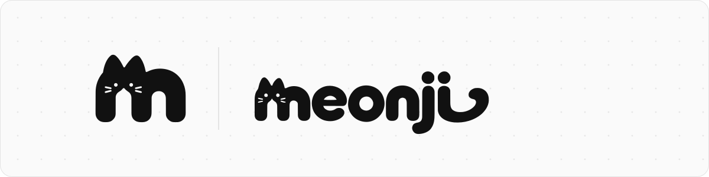
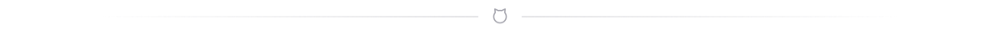
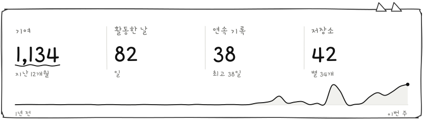
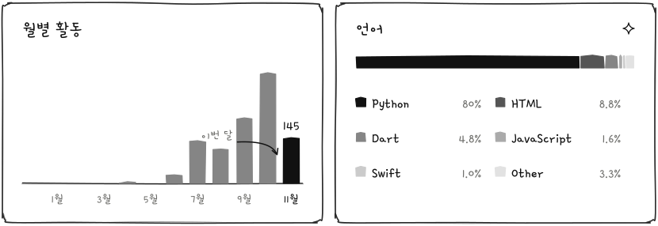
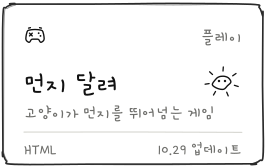
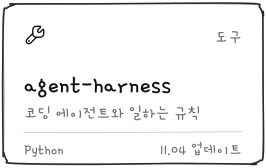
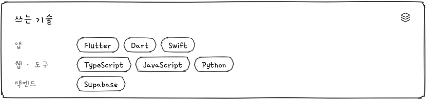
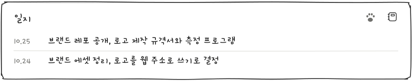
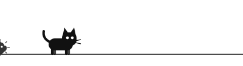

<picture>
  <source media="(prefers-color-scheme: dark)" srcset="./assets/banner-dark.svg">
  
</picture>

<h3>먼지(Meonji) dust factory</h3>

<picture>
  <source media="(prefers-color-scheme: dark)" srcset="./assets/divider-dark.svg">
  
</picture>

<picture><source media="(prefers-color-scheme: dark)" srcset="https://raw.githubusercontent.com/dustfactory/dustfactory/output/stats-dark.svg"></picture>

<picture><source media="(prefers-color-scheme: dark)" srcset="https://raw.githubusercontent.com/dustfactory/dustfactory/output/charts-dark.svg"></picture>

<a href="https://dustfactory.github.io/meonji-jump/"><picture><source media="(prefers-color-scheme: dark)" srcset="https://raw.githubusercontent.com/dustfactory/dustfactory/output/project-meonji-jump-dark.svg"></picture></a> <a href="https://github.com/dustfactory/MEONJI-Brand"><picture><source media="(prefers-color-scheme: dark)" srcset="https://raw.githubusercontent.com/dustfactory/dustfactory/output/project-meonji-brand-dark.svg"></picture></a> <a href="https://github.com/dustfactory/agent-harness"><picture><source media="(prefers-color-scheme: dark)" srcset="https://raw.githubusercontent.com/dustfactory/dustfactory/output/project-agent-harness-dark.svg"></picture></a>

<picture><source media="(prefers-color-scheme: dark)" srcset="https://raw.githubusercontent.com/dustfactory/dustfactory/output/stack-dark.svg"></picture>

<picture><source media="(prefers-color-scheme: dark)" srcset="https://raw.githubusercontent.com/dustfactory/dustfactory/output/cat-dark.svg"></picture>

<a href="journal/"><picture><source media="(prefers-color-scheme: dark)" srcset="https://raw.githubusercontent.com/dustfactory/dustfactory/output/journal-dark.svg"></picture></a>

<!-- GAMES:START -->

<a href="https://dustfactory.github.io/meonji-jump/"><picture><source media="(prefers-color-scheme: dark)" srcset="./assets/games/jump-preview-dark.svg"></picture></a> 
굴러오는 먼지를 뛰어넘는 달리기 게임 &nbsp;·&nbsp; <a href="https://dustfactory.github.io/meonji-jump/"><b>플레이하기 →</b></a>

<!-- GAMES:END -->

<!-- ADS:START -->

<a href="https://github.com/dustfactory/app-advertisements/blob/main/%EA%B1%B4%EB%84%88/%EC%99%84%EC%84%B1%EC%98%81%EC%83%81/%EA%B0%80%EB%A1%9C-16x9/Gunneo-Reel-30s-ko-StyleB-Kinetic.mp4"><b>건너 · Gunneo — 광고 보기 →</b></a> 
30초 광고 · 키네틱 타이포그래피 (Style B) · 1920×1080 · 60fps

<!-- ADS:END -->

<samp>먼지 · 2026</samp>

